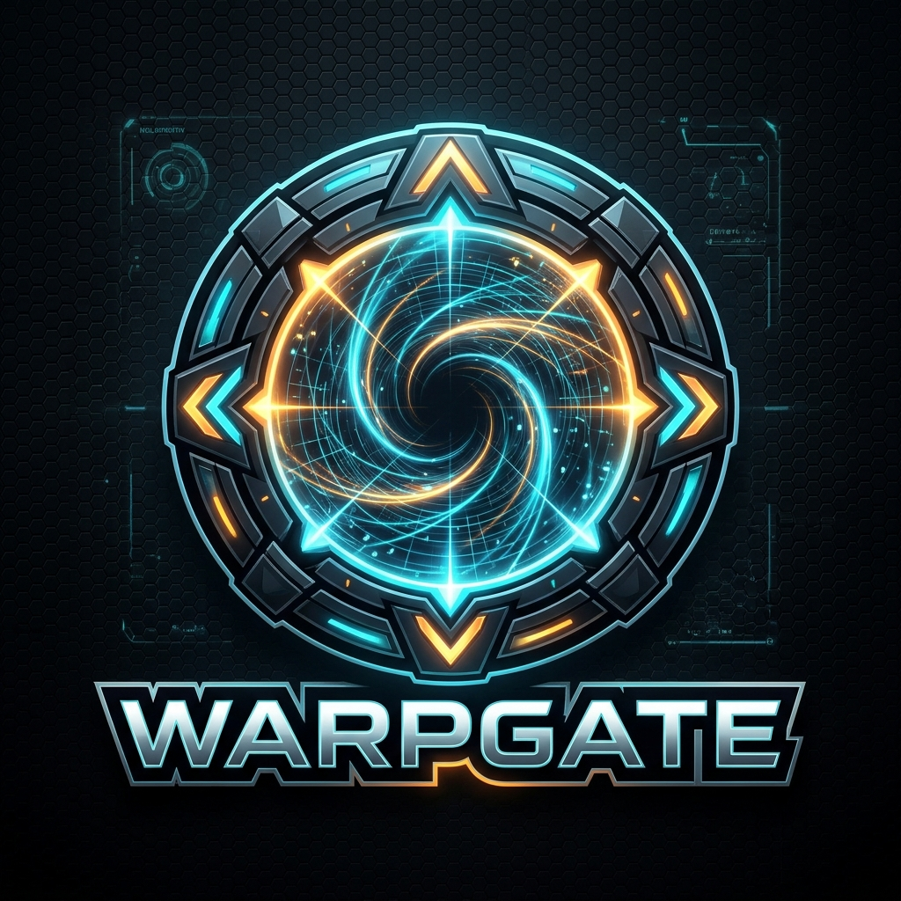

# <p align="center"><br><b>WARPGATE</b></p>
<p align="center">
  <b>Next-Generation Ultra-Low Latency PvP Server Selector & Region Lock</b><br>
  <i>Take complete control of your matchmaking routing across competitive shooters.</i>
</p>

<p align="center">
  
  
  
  
  
</p>

---

## ⚡ What is WARPGATE?

**WARPGATE** is a modern, high-performance network routing tool designed for competitive PC gamers who demand strict matchmaking latency. 

Instead of letting game matchmaking algorithms randomly throw you onto distant or unstable server clusters with high ping and packet loss, **WARPGATE** leverages native **Windows Advanced Firewall rules** to filter out unwanted datacenters before the matchmaker can probe them.

### Supported Games
* 🎯 **Overwatch 2** (`Overwatch.exe`)
* 💥 **Battlefield 2042 & Battlefield 6** (`BF2042.exe` / `BF6.exe`)
* ⚡ **Apex Legends** (`r5apex.exe`)
* 🛡️ **Marvel Rivals** (`Marvel-Win64-Shipping.exe`)
* 🌐 **All Multiplayer Games** (System-wide global mode)

---

## 🚀 Key Features

* **🛡️ 100% Anti-Cheat Safe (Warden / Ricochet / EasyAntiCheat)**  
  Zero memory modification, zero DLL injection, zero game file tampering. WARPGATE operates purely on the OS network firewall level (`netsh advfirewall` & Windows Filtering Platform).
* **🎮 Dynamic Per-Game Server Lists & Profiles**  
  Switch seamlessly between Overwatch 2, Battlefield 2042 / 6, Apex Legends, Marvel Rivals, or Global Mode. The UI dynamically loads verified regional datacenters, official looking-glass ping targets, and IP CIDR pools tailored to each game's infrastructure.
* **🔄 Dual-Client Executable Binding (Steam & Battle.net / EA App)**  
  Automatically discovers and scopes firewall rules simultaneously across all installed client executables (Steam and Battle.net / EA App), eliminating the need to manually toggle or reconfigure paths.
* **🔒 Smart UDP Game Isolation**  
  Unlike legacy tools that cause *"Time out communicating with Battle.net services"* or EA App connection errors by blocking all traffic, WARPGATE blocks **UDP match routing only**, leaving critical TCP authentication, login tokens, patch downloaders, and Discord untouched.
* **⚡ Live Latency Monitor**  
  Real-time asynchronous ping telemetry using official regional peering endpoints (Blizzard AS57976 BGP nodes, i3D.net Looking Glass servers, and AWS regional endpoints) with color-coded status badges:
  - 🟢 Low Ping (<80ms)
  - 🟡 Moderate Ping (80–160ms)
  - 🔴 High Ping (>160ms)
* **🌐 Complete BGP & Cloud Prefix Coverage**  
  Integrated with all 102 official Blizzard European BGP prefixes (AS57976), verified i3D.net bare-metal server pools, and dynamic cloud IP synchronization directly with Google Cloud and AWS IP blocks.
* **📦 Portable Single-Executable**  
  No Python, no installers, no DLL configuration needed. Runs standalone straight from your desktop or USB drive with automatic UAC administrator privilege elevation.
* **🧹 One-Click & Standalone Reset Utility**  
  Quickly unblock all servers inside the app or run the standalone `RESET_FIREWALL_RULES.bat` script to restore default Windows Firewall configurations anytime.

---

## 🗺️ Supported Global Datacenters & Routing Maps

WARPGATE dynamically configures dedicated routing tables tailored to each game's hosting infrastructure:

<details open>
<summary><b>🎯 Overwatch 2 (Blizzard AS57976 + GCP / AWS)</b></summary>

| Region Identifier | City / Location | Infrastructure / Cloud Provider |
| :--- | :--- | :--- |
| **ORD1** | Chicago, IL, USA | Blizzard Core + Google Cloud (`us-central1`) |
| **LAX1** | Los Angeles, CA, USA | Blizzard Core / Silicon Valley / AWS West |
| **GUE4** | Ashburn, VA / Sterling | Blizzard Core / AWS East (`us-east-1`) |
| **AMS1** | Amsterdam, Netherlands | Blizzard European Hub (All 102 AS57976 BGP Prefixes) |
| **CDG1** | Paris, France | Blizzard Core European Node |
| **GEW3** | Frankfurt, Germany | Google Cloud (`europe-west3`) |
| **MES1** | Bahrain / UAE / Dubai | AWS Middle East (`me-central`) |
| **GTK1** | Tokyo, Japan | Blizzard Asia / AWS (`ap-northeast-1`) |
| **ICN1 / GAN3** | Seoul, South Korea | Blizzard Core / AWS (`asia-northeast3`) |
| **TPE1** | Taipei, Taiwan | HiNet / Blizzard Taiwan Core |
| **GSG1** | Singapore | Blizzard Southeast Asia Hub |
| **SYD2** | Sydney, Australia | AWS Oceania (`ap-southeast-2`) |
| **GBR1** | São Paulo, Brazil | AWS South America (`sa-east-1`) |

</details>

<details>
<summary><b>💥 Battlefield 2042 & Battlefield 6 (EA / i3D.net AS49544 + AWS)</b></summary>

| Region Identifier | City / Location | Infrastructure / Ping Target |
| :--- | :--- | :--- |
| **US_EAST** | Ashburn, VA, USA | i3D.net Bare Metal (`162.244.54.53`) + AWS East |
| **US_WEST** | San Jose / Los Angeles, CA | i3D.net Bare Metal (`162.244.52.53`) |
| **EU_CENTRAL** | Frankfurt / Amsterdam / Rotterdam | i3D.net European Main Hub (`213.163.64.1`) |
| **ASIA_TOKYO** | Tokyo, Japan | i3D.net Asia-East (`103.194.166.85`) |
| **ASIA_SINGAPORE** | Singapore | i3D.net Southeast Asia (`213.179.200.53`) |
| **OCEANIA_SYDNEY** | Sydney, Australia | i3D.net Oceania (`109.200.215.1`) |
| **SA_SAOPAULO** | São Paulo, Brazil | i3D.net South America (`185.197.24.1`) |
| **ME_AFRICA** | Dubai / Johannesburg | i3D.net Middle East & Africa (`185.50.104.1`) |

</details>

<details>
<summary><b>⚡ Apex Legends (Respawn / EA AWS + GCP)</b></summary>

| Region Identifier | City / Location | Infrastructure / Ping Target |
| :--- | :--- | :--- |
| **US_EAST_1** | N. Virginia / Ohio | AWS `us-east-1` (`dynamodb.us-east-1.amazonaws.com`) |
| **US_WEST_2** | Oregon / N. California | AWS `us-west-2` (`dynamodb.us-west-2.amazonaws.com`) |
| **EU_CENTRAL_1** | Frankfurt / London / Ireland | AWS `eu-central-1` (`dynamodb.eu-central-1.amazonaws.com`) |
| **AP_NE_1** | Tokyo, Japan | AWS `ap-northeast-1` (`dynamodb.ap-northeast-1.amazonaws.com`) |
| **AP_SE_1** | Singapore / Hong Kong | AWS `ap-southeast-1` (`dynamodb.ap-southeast-1.amazonaws.com`) |
| **AP_SE_2** | Sydney, Australia | AWS `ap-southeast-2` (`dynamodb.ap-southeast-2.amazonaws.com`) |
| **SA_EAST_1** | São Paulo, Brazil | AWS `sa-east-1` (`dynamodb.sa-east-1.amazonaws.com`) |
| **ME_SOUTH_1** | Bahrain / UAE | AWS `me-south-1` (`dynamodb.me-south-1.amazonaws.com`) |

</details>

<details>
<summary><b>🛡️ Marvel Rivals (NetEase / AWS GameLift)</b></summary>

| Region Identifier | City / Location | Infrastructure / Ping Target |
| :--- | :--- | :--- |
| **DALLAS** | Dallas, TX / Ohio | NetEase Central Node / AWS `us-east-2` |
| **VA_EAST** | Northern Virginia | NetEase US-East Hub / AWS `us-east-1` |
| **OREGON_WEST** | Oregon / Pacific Northwest | NetEase US-West Hub / AWS `us-west-2` |
| **FRANKFURT** | Frankfurt, Germany / Warsaw | NetEase Europe Hub / AWS `eu-central-1` |
| **TOKYO** | Tokyo, Japan | NetEase Asia-East Cluster / AWS `ap-northeast-1` |
| **SINGAPORE** | Singapore | NetEase SE-Asia Cluster / AWS `ap-southeast-1` |
| **SYDNEY** | Sydney, Australia | NetEase Oceania / AWS `ap-southeast-2` |
| **SAOPAULO** | São Paulo, Brazil | NetEase South America / AWS `sa-east-1` |
| **DAMMAM** | Dammam, Saudi Arabia / Bahrain | NetEase Middle East / AWS `me-south-1` |

</details>

<details>
<summary><b>🌐 All Games (Global Mode)</b></summary>

Applies system-wide firewall rules across all outbound UDP multiplayer matchmaking traffic for North America Central, West, East, Europe, Asia (Tokyo/Singapore), Oceania, and the Middle East without executable-specific scoping.

</details>

---

## 💻 Quick Start Guide

### Option 1: Run the Precompiled Standalone Executable (Recommended)
1. Head to the **[Releases](https://github.com/iammrwrath/warpgate-server-selector/releases)** or your local `dist/` directory.
2. Launch **`PvP-Server-Selector.exe`** (accept the Windows UAC Administrator prompt).
3. Select your target game from the dropdown.
4. Select your preferred region tile to inspect live ping latencies.
5. Click **"🔒 Lock Selected Region"**.
6. Launch your game and queue into competitive matches!

### Option 2: Running from Source
```bash
# Clone the repository
git clone https://github.com/iammrwrath/warpgate-server-selector.git
cd warpgate-server-selector

# Install dependencies
python -m pip install -r requirements.txt

# Run WARPGATE (Run terminal as Administrator)
python modern_app.py
```

### Option 3: Building the Standalone Executable
```bash
python -m pip install pyinstaller
python -m PyInstaller --clean build_portable.spec
```
The output executable will be generated at `dist/PvP-Server-Selector.exe`.

---

## ❓ Frequently Asked Questions

<details>
<summary><b>Can I get banned for using WARPGATE?</b></summary>
No. WARPGATE does not touch the game client, memory, or storage. It functions identically to configuring outbound packet rules in Windows Defender Firewall or setting QoS rules in your router.
</details>

<details>
<summary><b>Will this kick me from Battle.net or the EA App?</b></summary>
No. WARPGATE specifically implements smart UDP filtering. Platform authentication, license verification, and text/voice chat operate over TCP (ports 80, 443, 1119, 3724) and remain untouched.
</details>

<details>
<summary><b>How do I check which server I am currently on in Overwatch 2?</b></summary>
In an active match or in the Practice Range, press <code>Ctrl + Shift + N</code> to toggle the NetGraph. Look at the top-left corner next to the IP address to see the four-letter server identifier (e.g. <code>[ORD1]</code>).
</details>

<details>
<summary><b>How do I reset all firewall rules?</b></summary>
Simply open the tool and click <b>"🔓 Reset / Unblock All"</b>. All custom server routing rules will be wiped instantly.
</details>

---

## 📜 License & Acknowledgments
* **Author / Maintainer**: [iammrwrath](https://github.com/iammrwrath)
* Originally based on the foundational research of `foryVERX/Overwatch-Server-Selector`.
* Licensed under the MIT License.
